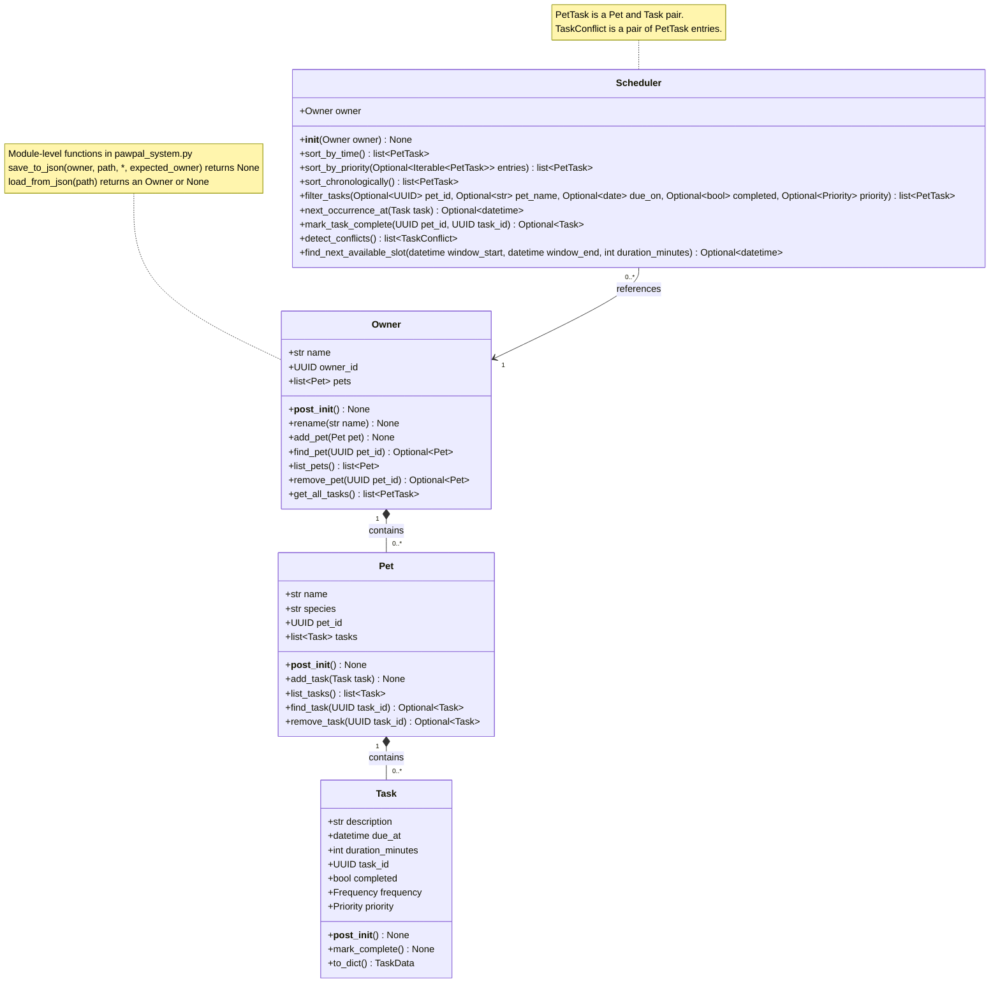

# PawPal+ · Pet Care Scheduler

## Project Overview

PawPal+ helps one owner coordinate meals, walks, medication, grooming, and appointments for multiple pets. It is a Python and Streamlit project for CodePath AI110, Module 2.

The assignment follows an object-oriented design workflow. It starts with UML and class responsibilities, then moves through scheduling logic, tests, and a Streamlit interface. The course scenario asks for a daily care plan that accounts for time, priorities, and owner preferences and can explain its choices. This submission provides an ordered daily view, conflict warnings, and earliest-slot suggestions. The remaining parts of that broader planning goal are listed under [Limitations and Design Tradeoffs](#limitations-and-design-tradeoffs).

## Features

- Add and remove pets, with confirmation before removal. Pets with the same name remain distinguishable by ID.
- Schedule one-time, daily, or weekly tasks with a start time, duration, and priority.
- View today's schedule and counts for pets, pending tasks, and completed tasks.
- Filter the full schedule by pet or completion status and sort by time or priority.
- Mark recurring tasks complete while retaining history and creating the next occurrence.
- Review same-start conflict warnings, search for an available slot, and save the owner's schedule locally.

## System Architecture

[`pawpal_system.py`](pawpal_system.py) contains the domain model, scheduler, and JSON functions. The scheduler reads each pet's task collection through the owner, keeping the pet association for every result. [`main.py`](main.py) demonstrates the backend with fixed sample data. [`app.py`](app.py) renders the dashboard, forms, and schedule with Streamlit, and publishes session changes after a successful save.

## Core Classes and Responsibilities

| Class | Responsibility |
|---|---|
| `Owner` | Stores the owner's name and UUID, manages pets, and exposes all tasks as `(pet, task)` pairs through `get_all_tasks()`. |
| `Pet` | Stores a name, species, and UUID. Adds, finds, lists, and removes its tasks by ID. |
| `Task` | Validates care-task fields, tracks completion, and serializes its UUID and due datetime through `to_dict()`. |
| `Scheduler` | Reads one owner's schedule to sort, filter, complete recurring tasks, detect same-start conflicts, and suggest free intervals. |

## UML Class Diagram

See the [submitted UML source](diagrams/uml.mmd), the identical [final UML source](diagrams/uml_final.mmd), and the [preserved draft UML](diagrams/uml_draft.mmd). The final diagram shows module-level JSON functions in a note.

<details>
<summary>Preview final UML</summary>



</details>

## Project Structure

```text
PawPal-/
├── app.py                       # Streamlit interface
├── main.py                      # Reproducible CLI demonstration
├── pawpal_system.py             # Domain classes, scheduler, and JSON functions
├── requirements.txt             # Streamlit and pytest
├── .streamlit/config.toml        # Theme and static image serving
├── assets/pawpal.css              # UI styling
├── static/pets-at-home.jpg        # Dashboard image
├── diagrams/
│   ├── uml.mmd                   # Final diagram at the assignment path
│   ├── uml_draft.mmd             # Preserved design draft
│   └── uml_final.mmd             # Final implemented class diagram
├── tests/
│   ├── test_pawpal.py
│   └── test_stretch_features.py
├── reflection.md                 # Course questions and evidence-based draft notes
├── ai_interactions.md            # Agent workflow and prompt comparison
└── data/data.json                # Local schedule created on the first save
```

## Installation and Setup

Run the commands in this README from the repository root. Use Python 3.10 or newer. The captured demonstrations were run with Python 3.11.4.

macOS or Linux:

```bash
python3 -m venv .venv
source .venv/bin/activate
python -m pip install -r requirements.txt
```

Windows PowerShell:

```powershell
py -m venv .venv
.venv\Scripts\Activate.ps1
python -m pip install -r requirements.txt
```

## Running the CLI Demo

```bash
python main.py
```

The demo uses January 15, 2026, and writes its JSON round trip to a temporary directory. Captured output:

<details>
<summary>Full CLI output</summary>

```text
=== Core scheduling ===

Today's Schedule — Thursday, January 15, 2026
Due                     | Pet     | Task            | Priority | Status
------------------------+---------+-----------------+----------+--------
Thu, Jan 15, 2026 07:30 | Mochi   | Serve breakfast | High     | Pending
Thu, Jan 15, 2026 07:30 | Biscuit | Morning walk    | Medium   | Pending
Thu, Jan 15, 2026 12:00 | Mochi   | Give medication | High     | Pending
Thu, Jan 15, 2026 15:00 | Biscuit | Vet appointment | High     | Pending
Thu, Jan 15, 2026 17:30 | Biscuit | Serve dinner    | Medium   | Pending
Thu, Jan 15, 2026 18:00 | Mochi   | Brush coat      | Low      | Pending

Filtered schedule — Mochi, pending, High priority
Due                     | Pet   | Task            | Priority | Status
------------------------+-------+-----------------+----------+--------
Thu, Jan 15, 2026 07:30 | Mochi | Serve breakfast | High     | Pending
Thu, Jan 15, 2026 12:00 | Mochi | Give medication | High     | Pending

Scheduling conflicts
WARNING [Thu, Jan 15, 2026 07:30] Mochi: Serve breakfast / Biscuit: Morning walk share a start time.

Recurring tasks
Completed Mochi's serve breakfast (daily).
Next occurrence: Fri, Jan 16, 2026 07:30
Completed Mochi's brush coat (weekly).
Next occurrence: Thu, Jan 22, 2026 18:00

Completed task history
Due                     | Pet   | Task            | Priority | Status
------------------------+-------+-----------------+----------+----------
Thu, Jan 15, 2026 07:30 | Mochi | Serve breakfast | High     | Completed
Thu, Jan 15, 2026 18:00 | Mochi | Brush coat      | Low      | Completed

=== Stretch features ===

Next available slot — 20 minutes between 07:30 and 09:00
Earliest start: Thu, Jan 15, 2026 08:00

Priority order — pending tasks
Due                     | Pet     | Task            | Priority | Status
------------------------+---------+-----------------+----------+--------
Thu, Jan 15, 2026 12:00 | Mochi   | Give medication | High     | Pending
Thu, Jan 15, 2026 15:00 | Biscuit | Vet appointment | High     | Pending
Fri, Jan 16, 2026 07:30 | Mochi   | Serve breakfast | High     | Pending
Thu, Jan 15, 2026 07:30 | Biscuit | Morning walk    | Medium   | Pending
Thu, Jan 15, 2026 17:30 | Biscuit | Serve dinner    | Medium   | Pending
Thu, Jan 22, 2026 18:00 | Mochi   | Brush coat      | Low      | Pending

JSON persistence — temporary round trip
Restored Jordan, 2 pets, and 8 tasks with their original IDs.
```

</details>

## Running the Streamlit Application

```bash
python -m streamlit run app.py
```

Open the local URL printed in the terminal. Streamlit loads saved data when the session starts and creates the local JSON file on the first successful save.

## Demo Walkthrough

1. Open **Pets**, enter a name, choose a species, and select **Add pet**. Repeat for a second pet if you want to demonstrate an owner-wide conflict.
2. In **Tasks**, select a pet. Enter a task description, due date and time, duration, frequency, and priority. Select **Add task**.
3. Open **Dashboard** to see today's entries and task counts. Open **Schedule** for the full list.
4. In **Schedule**, use **Filter by pet** and **Completion status** to narrow the table. Use **Sort by** to switch between chronological and priority order.
5. To complete a recurring task, go to **Tasks**, select the same pet and a **Pending task**, and select **Mark complete**. The original stays in the history, and a daily or weekly task gets one new occurrence.
6. To review a conflict, create two pending tasks at the same start time and look for **Scheduling conflicts** on the **Schedule** tab. The warning covers the owner's whole schedule, including tasks hidden by the current filters.
7. Expand **Find an available slot** in **Schedule**. Enter the earliest start, latest end, and required duration, then select **Find slot** to see the earliest fit.

## Smarter Scheduling

| Implemented method | Behavior |
|---|---|
| `sort_by_time()` | Sorts pet-task pairs by due datetime and retains their input order for ties. |
| `sort_chronologically()` | Compatibility method that delegates to `sort_by_time()`. |
| `sort_by_priority(entries=None)` | Sorts by High, Medium, and Low priority, then by due datetime. It also accepts filtered pairs. |
| `filter_tasks()` | Combines optional pet ID, exact case-insensitive pet name, due date, completion status, and priority using AND. Use `completed=False` for pending tasks. The Streamlit schedule exposes pet and completion filters. |
| `next_occurrence_at(task)` | Returns the original due datetime plus one day for daily tasks or seven days for weekly tasks. It returns `None` for one-time tasks. |
| `mark_task_complete(pet_id, task_id)` | Keeps the completed occurrence and attaches a new pending occurrence for a recurring task. Repeating completion of the same occurrence does not add another task. |
| `detect_conflicts()` | Returns pairs of pending tasks with identical starts across the owner's schedule. |
| `find_next_available_slot(window_start, window_end, duration_minutes)` | Returns the earliest start that fits around pending task durations, or `None`. |

## Advanced Scheduling and Stretch Features

- **Priority ordering.** `sort_by_priority()` changes the display order while preserving each task's scheduled time.
- **Earliest-slot search.** The scheduler sorts occupied intervals by start and scans for the first gap that fits. Overlapping intervals extend the blocked period to the furthest end. Tasks may touch at an endpoint, and completed tasks do not occupy time. For `p` pets, `n` tasks, and `b` occupied intervals intersecting the search window, the scan and its setup take `O(p + n + b log b)` time and `O(n + b)` auxiliary space.
- **JSON and presentation.** The local JSON round trip and formatted CLI and Streamlit views are described below.

## JSON Persistence

The default save location is `data/data.json` under the repository root. `save_to_json()` creates the directory if needed and writes the owner, pets, and tasks with UUID strings and ISO-formatted datetimes. `load_from_json()` reconstructs the domain objects and returns `None` if the file is missing.

Streamlit loads a snapshot at the start of a session. It saves changes to a temporary file beside the existing JSON and replaces the original after validation. Invalid JSON, including non-finite literals such as `NaN`, produces a readable error and is left intact. Streamlit compares the saved snapshot before writing, including the original ISO datetime offsets. If a save fails, the app keeps the previous session state. The live data and temporary save files are ignored by Git. The CLI uses a separate temporary file.

## Professional Output Formatting

The CLI uses the standard library. `format_table()` calculates column widths, and `print_schedule()` formats dates, priority, and status for each row. Streamlit uses `show_task_table()` with `st.table()`, `st.metric()` for dashboard counts, and `st.warning()` for conflicts. `format_schedule_datetime()` keeps seconds and fractional seconds when present. Priority symbols include text labels.

## Testing PawPal+

Install dependencies as described in [Installation and Setup](#installation-and-setup), then run:

```bash
python -m pytest
```

For individual test names, run `python -m pytest -v`.

The suite covers model validation, cross-pet sorting and filtering, recurring completion, same-start conflicts, exact-fit and overlapping intervals, JSON integrity, and CLI isolation. Streamlit AppTest exercises the forms, sorting, conflict warnings, slot suggestions, reloads, and stale-session protection using test data.

Captured output from collection through the result:

```text
collected 66 items

tests/test_pawpal.py ..........................................          [ 63%]
tests/test_stretch_features.py ........................                  [100%]

============================== 66 passed in 1.07s ==============================
```

## Limitations and Design Tradeoffs

- The JSON store is designed for one owner using a local app process. It has no account isolation or cross-process transaction management.
- Same-start conflict warnings and duration-aware slot suggestions serve different purposes. Slot suggestions do not reserve a time or account for working hours, travel buffers, or parallel caregivers.
- Recurrence advances from the previous scheduled time, so completing an overdue task can produce another overdue occurrence.
- Streamlit uses UTC for aware schedules and rejects mixed aware and naive values. Local naive schedules use the host's clock. JSON preserves numeric UTC offsets.
- Task editing and automatic daily plan generation with owner preferences and explanations remain future work. The release checks used the CLI and automated tests, including Streamlit AppTest.

## AI-Assisted Development

The [AI interactions log](ai_interactions.md) records the Codex workflow, actual implementation prompts, verification, and the comparison of two interval algorithms. The [reflection](reflection.md) separates documented development events from personal responses that require student confirmation.
